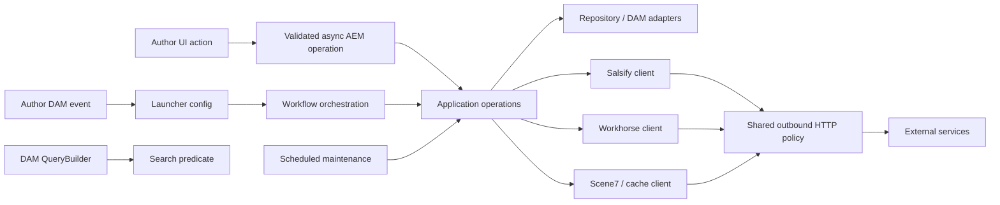

# Proposed design improvements

These are recommendations for incremental improvement, not a description of current behavior or a committed migration plan. Keep AEM workflows as the authoring/runtime boundary unless deployment evidence or product requirements justify changing that boundary.

## Recommended design direction

1. **Keep event/launcher matching declarative, make routing explicit.** Maintain a documented launcher-to-model table and add a lightweight configuration test that verifies paths, event types, MIME/property conditions, and model targets.
2. **Separate orchestration from operations.** Workflow process steps should orchestrate explicit application operations (asset metadata, collection lifecycle, asset movement) and integration ports rather than owning HTTP request construction and repository policy in one class.
3. **Define consistent integration contracts.** Make the HTTP client return a typed outcome or throw a domain-specific exception with status, retryability, and correlation ID. Encode query/body values, set explicit timeouts, redact secrets, and make callers handle non-success outcomes.
4. **Make write steps idempotent and recoverable.** For external updates and multi-step repository changes, define a stable asset/workflow idempotency key and retry policy. Persist enough operation state to resume or report partial completion; avoid blind retries of non-idempotent writes.
5. **Make author actions asynchronous and server-validated.** Move collection assignment to an AEM server-side operation endpoint or workflow. Pass the selected paths and a configured destination; validate permissions and destination membership server-side, return per-path outcomes, and make partial failures visible.
6. **Bound and report maintenance work.** Use explicit pagination/batch cursors for asset purging, expose processed/deleted/skipped/failed counts, and ensure the scheduler's final result reflects partial failures. Keep collection purge idempotent.
7. **Use least-privilege service principals and external secrets.** Remove source credential defaults; configure secrets through the platform's secret mechanism and scope service ACLs to the paths and operations actually required.
8. **Add tests at configuration boundaries.** Cover launcher predicates, workflow model targets/order, service-user ACLs, RepoInit JSON, TCS client/server interaction, Dispatcher filter/rewrite behavior, plus service and workflow failure contracts.
9. **Restore documentation accuracy.** Align the root README with the actual Maven reactor and document which AEM models are intentionally manual/external.

## Target logical architecture

The core improvement is not adding layers for their own sake: it is making configuration triggers, repository writes, external side effects, and recovery behavior explicit and testable.

See the [proposed architecture diagram](diagrams/proposed-architecture.mmd). Prioritize verification of deployed configuration and credential handling before changing workflow routing or permissions.
