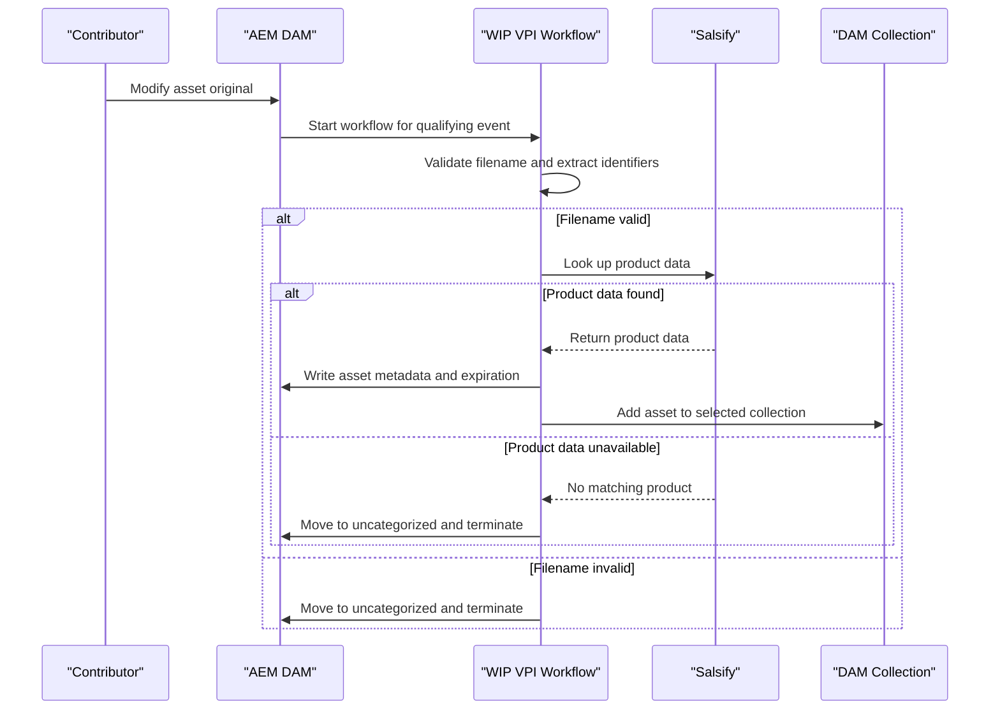

# Workflow process step reference

This reference explains all 14 custom `WorkflowProcess` implementations in [`core/.../workflows`](../../core/src/main/java/com/belk/aem/assets/core/workflows/). Each page describes model usage, inputs, conditions, repository changes, integrations, and failure behavior. A model reference does not prove that the model is automatically started in a deployed environment; see the [workflow catalog](../workflows/README.md) for launcher and invocation evidence.

The descriptions reflect the current working tree. In particular, the color-swatch process includes local, uncommitted changes; confirm the deployed code and model version before using its described error handling in an incident. Adobe-owned workflow processes referenced by the models are outside this Java package and are not documented as Belk implementations.

## Process step index

Model names below omit the `belk-` prefix.

| Process | Configured model(s) | Main job |
|---|---|---|
| [FileNameMetadataExtraction](FileNameMetadataExtraction.md) | vendor-provided-images, sample-images, post-processing-sample-vpi, metadata-asset-workflow | Validate and parse filename into workflow metadata. |
| [DamAssetMetadataUpdate](DamAssetMetadataUpdate.md) | vendor-provided-images, sample-images, post-processing-sample-vpi, metadata-asset-workflow | Read Salsify product data and write DAM metadata. |
| [AssetMoveProcess](AssetMoveProcess.md) | sample-images, post-processing-sample-vpi | Move assets based on metadata and store the moved path. |
| [CollectionCreationProcess](CollectionCreationProcess.md) | vendor-provided-images, sample-images | Select a dated collection and add the asset. |
| [AssociatePSDImageProcess](AssociatePSDImageProcess.md) | post-processing-sample-vpi | Find matching WIP assets and add relations. |
| [UpdateRelatedAssetSalsifyMetadata](UpdateRelatedAssetSalsifyMetadata.md) | post-processing-sample-vpi | Copy selected DAM metadata to matched assets. |
| [InvokeWorkflowModel](InvokeWorkflowModel.md) | batch-thumbnails-post-to-salsify-call | Start child workflows; additional routing branches are not shown wired by the checked-in models. |
| [ExtractMetadataForColorSwatchesProcess](ExtractMetadataForColorSwatchesProcess.md) | post-scene7-urls-to-salsify | Build and persist Scene7 URL metadata. |
| [SalsifyDataUpdateProcess](SalsifyDataUpdateProcess.md) | post-scene7-urls-to-salsify | Request a Salsify image URL update. |
| [SalsifyEcommStatusUpdateProcess](SalsifyEcommStatusUpdateProcess.md) | sample-images | Conditionally request the Shots Selected status. |
| [SalsifyOnAssetSaveProcess](SalsifyOnAssetSaveProcess.md) | asset-metadata-save | Conditionally request URL updates across NRF products. |
| [WorkHorseStatusProcess](WorkHorseStatusProcess.md) | sample-images, post-scene7-urls-to-salsify | Conditionally request a Workhorse status update. |
| [Scene7CDNCacheInvalidation](Scene7CDNCacheInvalidation.md) | post-scene7-urls-to-salsify, scene7-cdn-cache-invalidation | Request CDN invalidation for stored URLs. |
| [AddToTCSCollectionProcess](AddToTCSCollectionProcess.md) | assign-to-tcs | Create/find a TCS collection and add the asset. |

## Domain entities

| Entity | Meaning and relationship |
|---|---|
| DAM asset | Image or other asset being processed; its DAM metadata is separate from workflow metadata. |
| Salsify product | Product information looked up using filename-derived identifiers; used to enrich an asset or receive requested updates. |
| DAM collection | Group of related assets, selected by business metadata and date. |
| Workflow instance | Carries the payload and intermediate values such as `asset-path` and `assetList` between steps. |

## Service-to-domain mapping

| Service/context | Responsibility | Dependencies |
|---|---|---|
| AEM DAM workflow processes | Route assets, maintain metadata, collections, and relations. | JCR, DAM APIs, workflow engine. |
| Salsify integration | Look up product data and request status or URL updates. | Configured Salsify/integration HTTP endpoints. |
| Workhorse integration | Request image-status updates. | Configured Workhorse HTTP endpoint. |
| Scene7 integration | Request CDN invalidation for asset URLs. | Dynamic Media configuration and Scene7 API. |

## Primary workflows

- **WIP VPI:** filename extraction → Salsify lookup and DAM metadata → dated collection.
- **Sample model:** filename and DAM metadata → conditional Salsify/Workhorse status → move → collection.
- **Product post-Scene7:** URL metadata → Salsify URL request → CDN invalidation → conditional Workhorse status.
- **Product final-asset post-processing:** filename and DAM metadata → move → asset relations → metadata copy, if that model is started.

The sample and product final-asset models are defined, but the checked-in launcher/model wiring does not establish their normal automatic start. The [workflow catalog](../workflows/README.md) describes the evidence and other models.

## Cross-service data flows

The filename yields identifiers used to retrieve product data, which the metadata step maps to DAM properties. Later steps use those properties to route assets or construct requests. Scene7 URL processing reads Dynamic Media metadata and can request Salsify and Workhorse updates. A request or a workflow completion does not prove that a downstream system accepted or applied the change.

## Business workflow sequence

The following illustrates the configured WIP VPI model after a qualifying launcher event; it does not imply an automatic move to Product.

<!-- mermaid-checked: every participant uses `participant Id as "Label"`, no \n in aliases/messages/notes, every alt/opt/loop closed by end, no `:` inside any alias -->

## Business rules and decision logic

- Workflow metadata such as `dam:styleID` and `asset-path` is not the same as properties under `jcr:content/metadata`.
- `directShipFlag` affects WIP VPI collection selection and, in final-asset post-processing, VPI destination folders. Beauty and grouping collection conditions take precedence.
- Sample status requests require the sample model, `vendorProvidedImage == false`, and a non-`SW` shot.
- Several steps log and return or catch failures without failing the workflow. Review each page and instance history; do not infer downstream success from completion alone.
